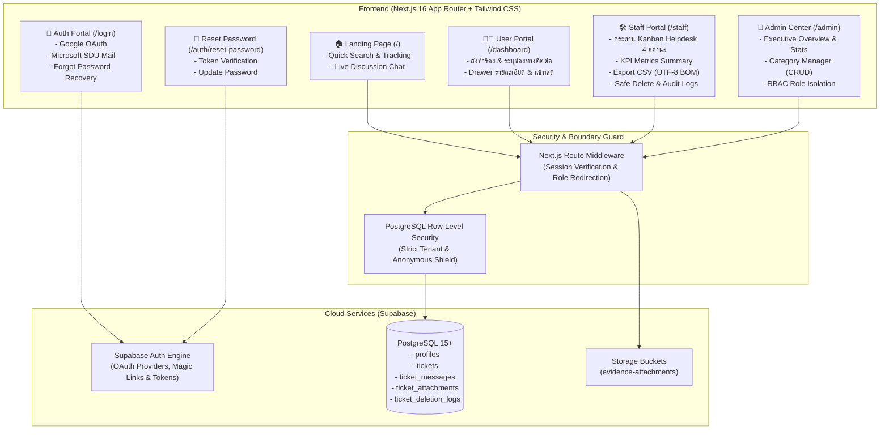
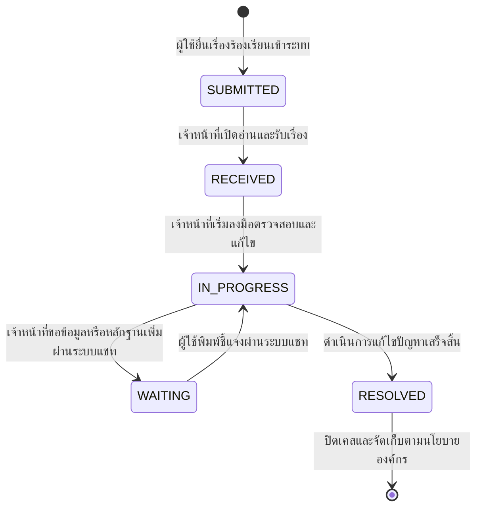

<div align="center">

# 🛡️ SDU Complaint Management System
### ระบบบริหารจัดการและติดตามเรื่องร้องเรียนระดับองค์กร (Enterprise Privacy-First Helpdesk Platform)

[](https://complaint-system-molq.vercel.app/)
[](https://nextjs.org/)
[](https://supabase.com/)
[](https://www.postgresql.org/)
[](https://tailwindcss.com/)
[](LICENSE)

<p align="center">
  <b>ระบบรับเรื่องร้องเรียนและข้อเสนอแนะ คณะวิทยาศาสตร์และเทคโนโลยี มหาวิทยาลัยสวนดุสิต</b><br>
  พัฒนาด้วยสถาปัตยกรรมระดับองค์กร (Clean Architecture) เน้นความปลอดภัยสูงสุดด้วย <b>Anonymous Whistleblower Protection</b>,<br>
  กระดาน <b>Kanban Helpdesk Board</b>, ระบบ <b>Audit Trail</b> ตรวจสอบย้อนหลังได้ 100%, และรองรับ <b>SSO (Google & Microsoft SDU Mail)</b>
</p>

🌐 **เข้าชมระบบจริงได้ที่:** [https://complaint-system-molq.vercel.app/](https://complaint-system-molq.vercel.app/)

---

</div>

## 📌 สรุปผลงานเด่นสำหรับ Portfolio & Resume (Project Highlights)

โปรเจกต์นี้ได้รับการออกแบบและพัฒนาเพื่อแก้ปัญหาการจัดการเรื่องร้องเรียนในองค์กรขนาดใหญ่ โดยผสานแนวคิด **Modern SaaS UI/UX (อ้างอิง Tasklify Pro & Newswire)** เข้ากับ **Security Engineering & Role-Based Access Control (RBAC)**:

1. **Enterprise Authentication & Single Sign-On (SSO):**
   * รองรับการล็อกอินด้วย **Google OAuth** และ **Microsoft 365 (Azure Entra ID / SDU Mail)**
   * หน้า Login/Register ออกแบบด้วยสถาปัตยกรรม **Adaptive UI**: บานเลื่อน *Sliding Door Animation (Desktop)* และ *Segmented Thumb Tabs (Mobile)*
   * **ระบบลืมรหัสผ่าน (Self-Service Password Recovery via Email):** ส่ง Magic Link ตรงเข้า Inbox เพื่อตั้งรหัสผ่านใหม่อย่างปลอดภัย
2. **Privacy-First Anonymous Whistleblower:**
   * สถาปัตยกรรมปกป้องตัวตนผู้ร้องเรียนขั้นสูงสุด: ข้อมูลชื่อและอีเมลของผู้ร้องเรียนจะถูกตัดทิ้งตั้งแต่ระดับ **PostgreSQL Row-Level Security (RLS)** เจ้าหน้าที่ (Staff) ไม่มีทางเข้าถึงข้อมูลผู้แจ้งได้ไม่ว่าจะผ่าน UI หรือ Direct Query
3. **Realtime Public Ticket Tracking (หน้าแรก):**
   * ประชาชนหรือผู้ร้องเรียนสามารถติดตามความคืบหน้าของเรื่องได้ทันทีผ่าน **Ticket Code (`TK-2026-XXXX`)** หรือ **รหัสลับส่วนตัว (`TRK-XXXX-YYYY`)** โดยไม่ต้องล็อกอิน พร้อมแชทสอบถามเจ้าหน้าที่ได้สดๆ
4. **Helpdesk Kanban Dashboard (Staff Portal):**
   * กระดาน Kanban 4 สถานะ จัดการตั๋วแบบ Realtime พร้อมแผง **Slide-over Drawer** เปิดดูรายละเอียดและพิมพ์ตอบกลับได้ในหน้าเดียว
   * กล่องสรุป **KPI Performance Metrics** แสดงอัตราความสำเร็จในการแก้ไข (Resolution Rate %)
5. **Data Export & Audit Trail Compliance:**
   * ส่งออกรายงานสถิติเป็น **Excel / CSV ด้วยการเข้ารหัส UTF-8 BOM (`\uFEFF`)** เปิดใน Microsoft Excel ภาษาไทยไม่เพี้ยน 100%
   * ระบบ **Safe Delete & Deletion Audit Logs**: บันทึกประวัติการลบคำร้องอย่างโปร่งใส (ใครลบ, ตั๋วไหน, วันที่, เหตุผล)

---

## 🌟 จุดเด่นและฟีเจอร์ของระบบ (Core Features)

| โมดูล / ฟีเจอร์ | รายละเอียดทางเทคนิค (Technical Details) |
| :--- | :--- |
| 🥷 **Anonymous Whistleblower** | ซ่อนตัวตนผู้แจ้งเบาะแส ปลอดภัยตามกฎหมาย PDPA ด้วย PostgreSQL RLS Policies |
| 🔍 **Public Ticket Tracking** | ติดตามสถานะผ่าน Ticket Code หรือ Tracking Code ลับหน้าแรกได้ทันทีโดยไม่ต้องล็อกอิน |
| 🔑 **Email Password Reset** | ระบบกู้คืนรหัสผ่านด้วย Magic Link ส่งเข้าอีเมลจริง และหน้าตั้งรหัสผ่านใหม่ที่ปลอดภัย |
| 🗂️ **Kanban Helpdesk Board** | แบ่งคอลัมน์สถานะชัดเจน (`รอดำเนินการ`, `กำลังตรวจสอบ`, `กำลังแก้ไข`, `เสร็จสิ้น`) |
| 👑 **Admin Executive Dashboard** | แดชบอร์ดสรุปสถิติผู้บริหาร สลับการทำงาน 3 แท็บ: คัดกรองเคส, จัดการหมวดหมู่, และแต่งตั้งสิทธิ์ User/Staff/Admin |
| 📥 **Export to Excel (UTF-8 BOM)** | ส่งออกรายงานเรื่องร้องเรียนเป็นไฟล์ `.csv` รองรับภาษาไทยสมบูรณ์แบบ เปิดใน Excel ทันที |
| 📜 **Audit Logs & Safe Deletion** | บันทึกประวัติการลบตั๋วลงตาราง Audit แยก ตรวจสอบย้อนหลังได้ตลอดเวลา |
| 💬 **Dual-Channel Discussion** | แชท 2 ทาง: คุยกับผู้ร้องเรียน (Public) หรือ บันทึกโน้ตลับปรึกษาภายในทีม (Internal Note 🔒) |
| 📎 **Evidence Attachment** | รองรับการแนบไฟล์ภาพและเอกสารหลักฐานผ่าน Supabase Object Storage |
| 📱 **Responsive Multi-Device** | ใช้งานลื่นไหลบนทุกหน้าจอ ทั้งสมาร์ทโฟน แท็บเล็ต และคอมพิวเตอร์ตั้งโต๊ะ |

---

## 🏗️ สถาปัตยกรรมระบบ (System Architecture)



---

## 🔄 วงจรสถานะของเรื่องร้องเรียน (Ticket Lifecycle State Machine)



---

## 🛠️ เทคโนโลยีที่ใช้ในการพัฒนา (Tech Stack)

* **Frontend Framework:** Next.js 16 (React 19 App Router)
* **Styling & Design System:** Tailwind CSS, Lucide React Icons
* **Backend as a Service:** Supabase (Database, Auth, Storage)
* **Database Management:** PostgreSQL with Row Level Security (RLS) & Triggers
* **Authentication:** Supabase Auth (Email/Password, Google OAuth 2.0, Microsoft Azure Entra ID / SDU Mail)
* **Storage Solution:** Supabase Object Storage (Evidence files upload)
* **Data Processing:** Native UTF-8 BOM CSV Generator for Excel Thai localization
* **Hosting & CI/CD:** Vercel Production Deployment

---

## 🚀 คู่มือการติดตั้งและรันโปรเจกต์ (Installation & Setup)

### 1. Clone Repository & ติดตั้ง Dependencies
```bash
git clone https://github.com/Hosxiz/complaintSystem.git
cd complaintSystem
npm install
```

### 2. กำหนดค่าตัวแปรสภาพแวดล้อม (Environment Variables)
สร้างไฟล์ `.env.local` ในไดเรกทอรีหลักของโปรเจกต์:
```env
NEXT_PUBLIC_SUPABASE_URL=https://your-project-id.supabase.co
NEXT_PUBLIC_SUPABASE_ANON_KEY=your-supabase-anon-key
```

### 3. เตรียมฐานข้อมูล (Database Migration)
รันไฟล์สคริปต์ SQL ใน **Supabase SQL Editor**:
1. `supabase/full_schema.sql` (โครงสร้างตารางหลัก, Enum, และ RLS)
2. `supabase/fix_ticket_delete_policy.sql` (สิทธิ์การลบคำร้องสำหรับ Staff/Admin และตาราง Audit Logs)
3. `supabase/storage_setup.sql` (สร้าง Storage Bucket `evidence-attachments`)

### 4. รัน Dev Server
```bash
npm run dev
```
เปิดเบราว์เซอร์ไปที่: `http://localhost:3000`

---

## 👨‍💻 ข้อมูลผู้พัฒนา (Author)
* **ผู้พัฒนา:** [@Hosxiz](https://github.com/Hosxiz)
* **สถาบัน:** คณะวิทยาศาสตร์และเทคโนโลยี มหาวิทยาลัยสวนดุสิต (Suan Dusit University)
* **ใบอนุญาต:** [MIT License](LICENSE)
