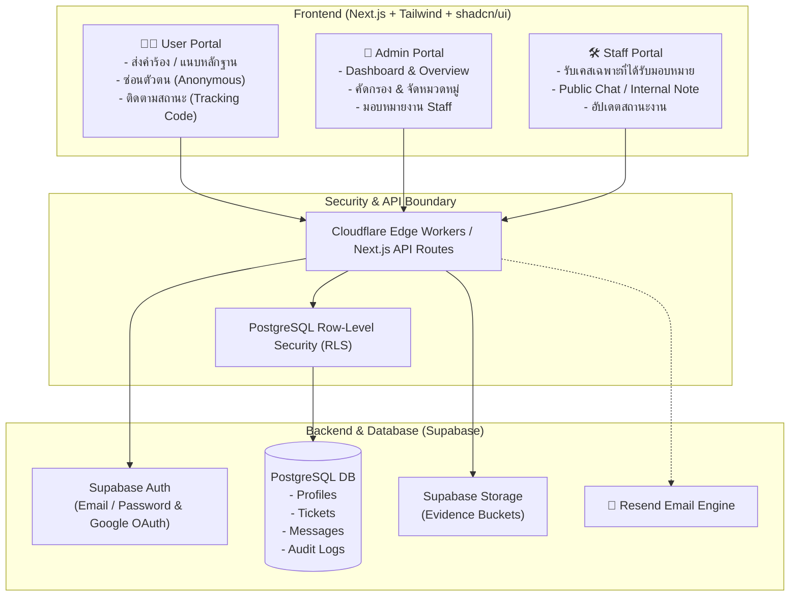
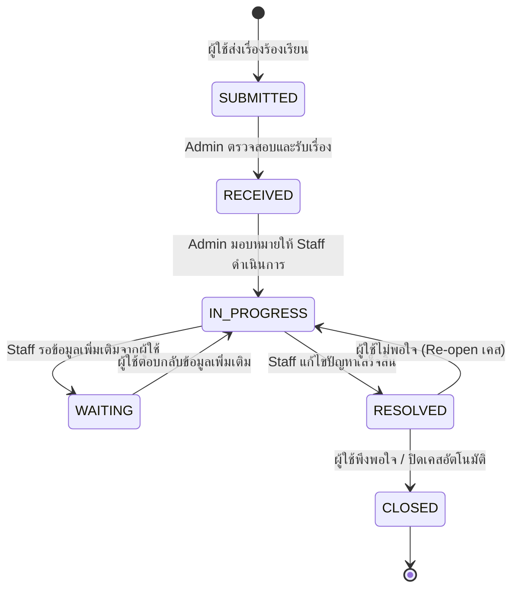
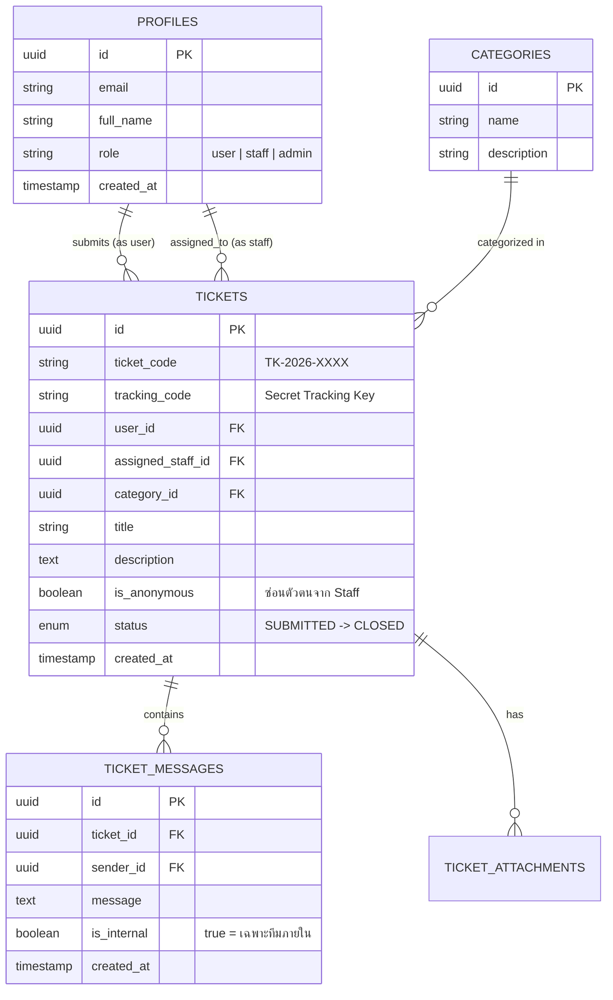

# 🛡️ Complaint Management System
### ระบบบริหารจัดการเรื่องร้องเรียนระดับองค์กร (Enterprise Grade)

  <b>ระบบจัดการเรื่องร้องเรียนที่ให้ความสำคัญกับความเป็นส่วนตัว (Privacy-First) คัดกรองรวดเร็ว และโปร่งใสตรวจสอบได้</b> 
  พร้อมสถาปัตยกรรม <b>Anonymous Whistleblower</b> ป้องกันข้อมูลรั่วไหลในระดับ Row-Level Security

---

## 🌟 จุดเด่นของระบบ (Key Features)

| ความสามารถ | รายละเอียด |
| :--- | :--- |
| 🕵️‍♂️ **Anonymous Whistleblower Mode** | ผู้ร้องเรียนสามารถเลือก "ซ่อนตัวตน" ได้ โดยเจ้าหน้าที่ (Staff) จะไม่สามารถเข้าถึงชื่อ/อีเมลของผู้ร้องเรียนได้ทั้งทาง UI และ Database Query |
| 🎫 **Smart Ticket & Tracking Code** | สร้างรหัสเคสอัตโนมัติ พร้อมรหัสลับติดตามเคส (Tracking Code) ให้ผู้ใช้เช็กความคืบหน้าได้ทันที |
| 👥 **3-Tier Role Permissions** | แยกสิทธิ์ชัดเจนระดับสถาปัตยกรรม: **User**, **Staff** (ดูเฉพาะเคสที่รับมอบหมาย), และ **Admin** (ควบคุมทุกภาพรวม) |
| 💬 **Dual-Channel Discussion** | แชทได้ทั้ง **Public Message** (สื่อสารกับผู้ร้องเรียน) และ **Internal Note** (คุยกันเฉพาะทีมภายใน ไม่เปิดเผยให้ User เห็น) |
| 📊 **Real-time Analytics Dashboard** | รายงานสถิติเคส คัดกรองหมวดหมู่ และระบบช่วยจับคู่แนะนำเจ้าหน้าที่ที่เหมาะสมโดยอัตโนมัติ |
| 🔔 **Omni-channel Notifications** | แจ้งเตือนความคืบหน้าทั้ง In-app Badge และส่งตรงถึงอีเมลผ่าน Resend |

---

## 🏗️ สถาปัตยกรรมระบบ (System Architecture)

---

## 🔄 วงจรสถานะของ Ticket (State Machine)

ระบบดำเนินเรื่องตามลำดับขั้นตอน เพื่อให้ตรวจสอบย้อนหลังและจัดการ SLA ได้อย่างแม่นยำ:

---

## 🗄️ โครงสร้างฐานข้อมูล (Database Schema Overview)

---

## 🚀 แผนการพัฒนา (Learning & Engineering Roadmap)

- [x] **Step 0:** วิเคราะห์ Requirement และวางสถาปัตยกรรมระบบ
- [ ] **Step 1:** ออกแบบฐานข้อมูล Supabase + เขียนคำสั่ง RLS Policies (เน้นศึกษา Data Security)
- [ ] **Step 2:** Scaffold โปรเจกต์ Next.js (App Router) + ติดตั้ง Tailwind CSS & shadcn/ui
- [ ] **Step 3:** ระบบ Authentication & Role-based Guards (Middleware ปกป้องหน้า Admin/Staff)
- [ ] **Step 4:** Ticket Engine & กลไก Anonymous + การสร้าง Tracking Code
- [ ] **Step 5:** พัฒนา 3 พอร์ทัลหลัก (User Portal, Staff Portal, Admin Dashboard)
- [ ] **Step 6:** ระบบส่งอีเมลแจ้งเตือนผ่าน Resend & Deploy ไปยัง Cloudflare

---

  Built with ❤️ for High-Quality System Engineering & Clean Code Education.

