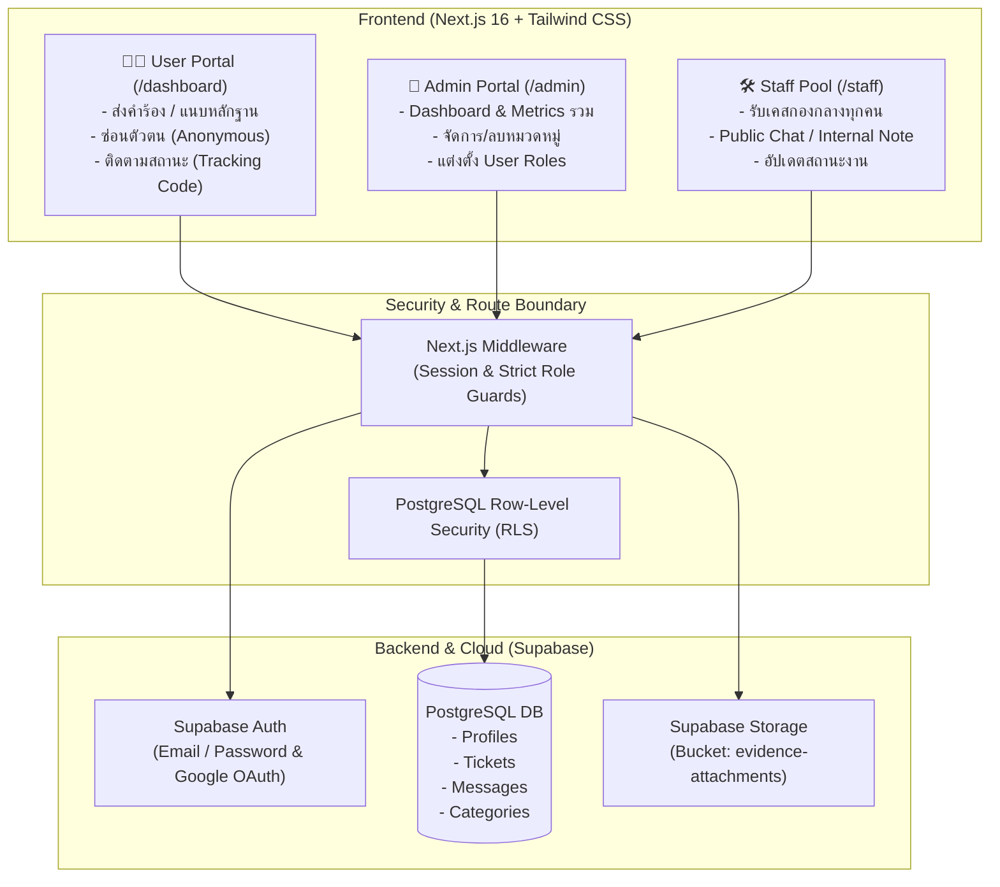
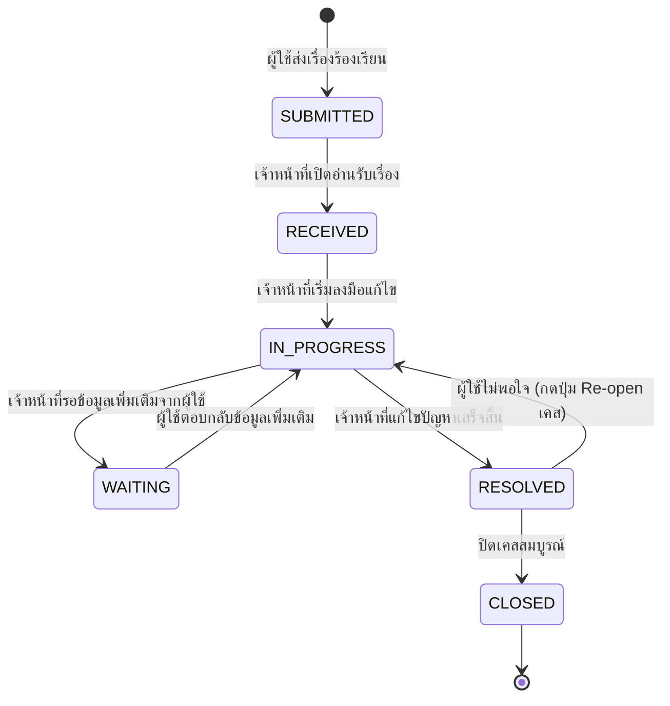

<div align="center">

# 🛡️ Complaint Management System
### ระบบบริหารจัดการเรื่องร้องเรียนระดับองค์กร (Enterprise Grade)

[](https://nextjs.org/)
[](https://supabase.com/)
[](https://tailwindcss.com/)
[](https://ui.shadcn.com/)

<p align="center">
  <b>ระบบจัดการเรื่องร้องเรียนที่ให้ความสำคัญกับความเป็นส่วนตัว (Privacy-First) คัดกรองรวดเร็ว และโปร่งใสตรวจสอบได้</b><br>
  พร้อมสถาปัตยกรรม <b>Anonymous Whistleblower</b> ป้องกันข้อมูลรั่วไหลในระดับ Row-Level Security
</p>

---

</div>

## 🌟 จุดเด่นของระบบ (Key Features)

| ความสามารถ | รายละเอียด |
| :--- | :--- |
| 🕵️‍♂️ **Anonymous Whistleblower Mode** | ผู้ร้องเรียนสามารถเลือก "ซ่อนตัวตน" ได้ โดยเจ้าหน้าที่ (Staff) จะไม่สามารถเข้าถึงชื่อ/อีเมลของผู้ร้องเรียนได้ทั้งทาง UI และ Database RLS |
| 🎫 **Smart Ticket & Tracking Code** | ออกรหัสเคสอัตโนมัติ (`TK-2026-XXXX`) พร้อมรหัสลับ (`TRK-XXXX-YYYY`) ให้ผู้ใช้ติดตามสถานะได้ทันทีโดยไม่ต้องล็อกอิน |
| 🔄 **Re-open Mechanism** | หากเรื่องมีสถานะแก้ไขเสร็จสิ้น (`RESOLVED`) แต่ผู้ใช้ยังพบปัญหา สามารถกดปุ่มขอเปิดเรื่องใหม่เพื่อส่งเคสกลับเข้าสู่การตรวจสอบได้ |
| 👥 **3-Tier Role Isolation** | แยกสิทธิ์การใช้งานเด็ดขาด: **User** (หน้าส่งเรื่อง), **Staff** (หน้ากองกลางงาน + ปรับสถานะ), และ **Admin** (ควบคุมภาพรวมทั้งระบบ) |
| 💬 **Dual-Channel Discussion** | ระบบแชท 2 ช่องทาง: **Public Message** (คุยกับผู้ร้องเรียน) และ **Internal Note 🔒** (กระซิบเฉพาะทีมงานหลังบ้าน) |
| 👑 **Admin Category & Role Manager** | แอดมินสามารถเพิ่ม/ลบหมวดหมู่ปัญหา และแต่งตั้งสิทธิ์ผู้ใช้งาน (`user` ↔ `staff` ↔ `admin`) ได้ทันที |
| 👤 **Profile & Security Settings** | ผู้ใช้สามารถแก้ไขชื่อ-นามสกุลจริง และเปลี่ยนรหัสผ่านใหม่ได้ตลอดเวลาผ่าน Navbar |
| 📱 **Responsive Adaptive Auth UI** | หน้า Login/Register แบบ Split Screen: มี **Sliding Curtain Animation** บนจอคอมพิวเตอร์ และสลับเป็น **Segmented Tabs** บนมือถือ |

---

## 🏗️ สถาปัตยกรรมระบบ (System Architecture)



---

## 🔄 วงจรสถานะของ Ticket (State Machine)



---

## 🚀 คู่มือการติดตั้งและเริ่มใช้งาน (Quick Start)

### 1. Clone Repository & ติดตั้ง Dependencies
```bash
git clone https://github.com/Hosxiz/complaintSystem.git
cd complaintSystem
npm install
```

### 2. ตั้งค่า Environment Variables
สร้างไฟล์ `.env.local` ในโฟลเดอร์โปรเจกต์:
```env
NEXT_PUBLIC_SUPABASE_URL=https://your-project-id.supabase.co
NEXT_PUBLIC_SUPABASE_ANON_KEY=your-anon-publishable-key
```

### 3. รัน Database Schema บน Supabase
นำโค้ดในไฟล์ [supabase/full_schema.sql](supabase/full_schema.sql) ไปวางใน **SQL Editor** บน Supabase แล้วกด **Run**

### 4. สตาร์ตเซิร์ฟเวอร์
```bash
npm run dev
```
เปิดเบราว์เซอร์เข้าใช้งานได้ที่ **`http://localhost:3000`**

---

## 📂 โครงสร้างไดเรกทอรี (Project Structure)

```
complaint-management-system/
├── .agents/                 # 7-Stage Engineering Pipeline & Specifications
│   ├── rules/               # บทบาทและข้อกำหนดของแต่ละ Agent
│   └── specs/               # ARCH_SPEC.md, UIUX_SPEC.md, QA_REPORT.md
├── docs/                    # คู่มือสถาปัตยกรรมระบบ (SYSTEM_GUIDE.md)
├── src/
│   ├── app/
│   │   ├── (auth)/login/    # หน้า Login/Register แบบ Sliding & Responsive
│   │   ├── admin/           # หน้าห้องควบคุมสำหรับ Admin
│   │   ├── dashboard/       # หน้าส่งเรื่องและติดตามเคสสำหรับ User
│   │   └── staff/           # หน้ากองกลางงานสำหรับ Staff
│   ├── components/
│   │   ├── admin/           # CategoryManager, UserRoleManager, AdminTicketQueue
│   │   ├── auth/            # EditProfileModal, ChangePasswordModal
│   │   ├── layout/          # Navbar with Strict Role Menus
│   │   ├── staff/           # StaffClientView, StaffStatusSelector
│   │   └── tickets/         # NewTicketForm, TicketTracker, TicketDiscussion
│   ├── lib/                 # Supabase clients & Utilities
│   └── middleware.js        # Route Guards ป้องกันการข้ามห้อง
└── supabase/                # SQL Migrations & Full Database Blueprint
```

---

<div align="center">
  <sub>Developed by <b>Hosxiz</b> with 7-Stage Automated Agent Team Pipeline.</sub>
</div>
